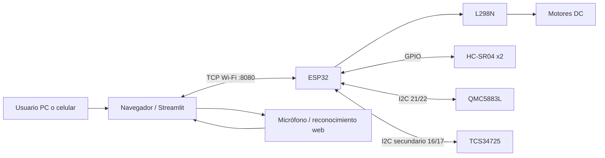

# JARVIS — Robot móvil inteligente con ESP32, Streamlit y voz

  

JARVIS es un robot móvil de dos motores que integra una ESP32, un puente H L298N, sensores de distancia, brújula electrónica y sensor de color. Se controla y supervisa desde una aplicación Streamlit por Wi-Fi local. Incluye telemetría, control manual, autonomía básica y reconocimiento de voz en navegador para órdenes y preguntas sobre el proyecto.

> Las credenciales Wi-Fi del firmware están reemplazadas por marcadores. No publiques tu contraseña ni tokens. La IP del robot puede cambiar y se debe actualizar en `src/web/app.py`.

## Contenido
- [Resumen](#resumen)
- [Objetivos](#objetivos)
- [Funciones](#funciones)
- [Arquitectura](#arquitectura)
- [Componentes](#componentes)
- [Pinout del prototipo](#pinout-del-prototipo)
- [Archivos](#archivos)
- [Instalación](#instalación)
- [Uso](#uso)
- [Comandos y preguntas](#comandos-y-preguntas)
- [Protocolo](#protocolo)
- [Explicación de los códigos](#explicación-de-los-códigos)
- [Dificultades y soluciones](#dificultades-y-soluciones)
- [Pruebas](#pruebas)
- [Limitaciones y mejoras](#limitaciones-y-mejoras)
- [Seguridad](#seguridad)
- [Licencia y autor](#licencia-y-autor)

## Resumen

El sistema está formado por dos partes. La ESP32 ejecuta el firmware, controla los motores, lee los sensores y publica telemetría. El computador ejecuta Streamlit, mantiene la conexión TCP, muestra los datos y permite enviar comandos. El celular puede abrir la interfaz desde el navegador si está conectado a la misma red Wi-Fi.

## Objetivo general
Construir un robot móvil conectado que integre electrónica, programación embebida, sensores, comunicación inalámbrica, supervisión web y una interfaz de voz.

## Objetivos específicos
1. Controlar motores DC desde ESP32 y L298N.
2. Medir distancias, rumbo magnético y valores de color.
3. Enviar telemetría JSON en tiempo real.
4. Implementar control manual desde un panel web.
5. Añadir una rutina autónoma elemental para evitar obstáculos.
6. Permitir órdenes y preguntas habladas en español.
7. Registrar los problemas de integración y las soluciones aplicadas.

## Funciones
- Wi-Fi STA y servidor TCP en el puerto 8080.
- Dos motores DC controlados por PWM y L298N.
- Dos sensores HC-SR04.
- QMC5883L: rumbo y componentes de campo magnético.
- TCS34725: canales rojo, verde, azul y clear.
- Telemetría JSON y panel Streamlit.
- Control manual, velocidad y modo autónomo básico.
- Reconocimiento de voz en navegador y respuestas locales sobre el proyecto.
- Acceso remoto dentro de la red local desde computador o celular.

## Arquitectura



## Componentes

| Componente | Propósito |
|---|---|
| ESP32 DevKit | Control central y conectividad Wi-Fi |
| L298N | Puente H para motores |
| Motores DC TT | Desplazamiento |
| HC-SR04 x2 | Distancia a obstáculos |
| QMC5883L | Orientación magnética |
| TCS34725 | Lectura RGB y luz clara |
| Chasis, ruedas y fuente | Estructura y alimentación |
| PC | Ejecuta Python y Streamlit |
| Celular | Control y voz desde navegador |

## Pinout del prototipo

**L298N**

| Señal | GPIO |
|---|---:|
| ENA | 25 |
| IN1 | 26 |
| IN2 | 27 |
| ENB | 23 |
| IN3 | 18 |
| IN4 | 19 |

**Ultrasónicos**

| Sensor | TRIG | ECHO |
|---|---:|---:|
| Izquierdo | 32 | 33 |
| Derecho | 13 | 14 |

**I²C**

| Sensor | SDA | SCL |
|---|---:|---:|
| QMC5883L | 21 | 22 |
| TCS34725 (bus separado) | 16 | 17 |

> ECHO del HC-SR04 puede entregar 5 V. Usa divisor resistivo/adaptador de nivel para no superar los 3,3 V de la ESP32. Revisa alimentación, tierras comunes y cableado antes de encender.

## Archivos

```text
.
├── README.md
├── requirements.txt
├── .gitignore
├── LICENSE
├── src/
│   ├── firmware/JARVIS_ESP32.ino
│   └── web/
│       ├── app.py
│       └── jarvis_voice/index.html
└── docs/
    ├── ARQUITECTURA_Y_FUNCIONAMIENTO.md
    ├── CODIGO_EXPLICADO.md
    ├── DIFICULTADES_Y_SOLUCIONES.md
    ├── INSTALACION_Y_PRUEBAS.md
    └── COMANDOS_Y_TELEMETRIA.md
```

## Instalación

### Firmware
1. Abre `src/firmware/JARVIS_ESP32.ino` en Arduino IDE.
2. Instala `QMC5883LCompass`, `Adafruit TCS34725` y las dependencias que el gestor de librerías indique.
3. Selecciona la placa ESP32 y el puerto COM.
4. Completa `WIFI_SSID` y `WIFI_PASSWORD` con tu red 2,4 GHz.
5. Carga el sketch y abre Monitor Serial a 115200 baudios.
6. Copia la IP que imprime la ESP32.

### Aplicación
Instala Python 3 y ejecuta:

```bash
python -m pip install -r requirements.txt
```

Edita `src/web/app.py` y configura `ESP32_IP` con la IP real del Monitor Serial. Después:

```bash
cd src/web
python -m streamlit run app.py --server.address 0.0.0.0
```

El terminal mostrará la URL local y la URL de red. Para usar el celular, conéctalo a la misma Wi-Fi y abre la URL de red. Mantén el PC y Streamlit encendidos.

Permite Python en el Firewall de Windows para redes privadas si el sistema lo solicita. Para voz, concede permiso de micrófono y utiliza un navegador Chromium actualizado que soporte la API de reconocimiento.

## Uso
1. Enciende el robot y confirma la IP por Serial.
2. Ejecuta Streamlit.
3. Conecta el panel a la ESP32.
4. Comprueba que la telemetría se actualice.
5. Prueba los botones con ruedas elevadas.
6. Prueba autonomía en un espacio despejado.
7. Usa el micrófono para comandos o preguntas.

## Comandos y preguntas

| Voz | Acción o respuesta |
|---|---|
| “avanza”, “adelante” | Adelante |
| “retrocede”, “hacia atrás” | Atrás |
| “gira a la izquierda” | Giro izquierdo |
| “gira a la derecha” | Giro derecho |
| “detente”, “frena” | Stop |
| “activa autonomía” | Modo autónomo |
| “modo manual” | Desactiva autonomía |
| “¿de qué trata el proyecto?” | Explicación del proyecto |
| “¿qué sensores tiene?” | Componentes sensoriales |
| “¿qué rumbo marca la brújula?” | Respuesta con valor actual |

Las respuestas conversacionales son una base de conocimiento local, no un chatbot de propósito general. La síntesis de voz la realiza el navegador.

## Protocolo

La versión incluida usa TCP, puerto 8080. Los comandos son texto simple terminado por `\n` (LF), por ejemplo:

```text
adelante
atras
izquierda
derecha
detener
auto
manual
speed=170
```

La ESP32 envía una línea JSON por intervalo. Campos principales:

- `left_distance`, `right_distance`
- `heading`, `compass_x`, `compass_y`, `compass_z`
- `red`, `green`, `blue`, `clear`, `color`
- `mode`, `movement`, `speed`

El firmware y `app.py` deben mantener los mismos nombres y formato.

## Explicación de los códigos

Consulta [`docs/CODIGO_EXPLICADO.md`](docs/CODIGO_EXPLICADO.md). En resumen:
- **Firmware:** inicializa pines, PWM y sensores; conecta Wi-Fi; acepta cliente TCP; separa comandos por salto de línea; aplica órdenes a motores; ejecuta la máquina de estados autónoma; empaqueta telemetría JSON.
- **`app.py`:** construye la interfaz Streamlit; gestiona socket; manda órdenes; recibe líneas JSON; convierte datos a indicadores; normaliza voz y distingue comandos de preguntas.
- **`jarvis_voice/index.html`:** solicita micrófono, usa reconocimiento de voz del navegador, devuelve texto a Streamlit y activa síntesis de voz cuando recibe respuesta.

## Dificultades y soluciones

- **TCP “conectado” pero los botones no movían:** la conexión solo indica que el socket se abrió. El texto de comando y su terminador no coincidían con el parser del firmware. Se alineó el protocolo y se terminó cada comando con LF.
- **Telemetría ausente o valores sin actualizar:** se verificó la estructura JSON y el mapeo de claves entre firmware y Python.
- **Reconocimiento de voz inestable con grabación y servicio de reconocimiento:** se cambió a reconocimiento nativo del navegador compatible, evitando una ruta de procesamiento adicional.
- **App en blanco/NameError durante iteraciones:** se corrigieron errores de variables y bloques; se recomienda mantener copia de la última versión funcional.
- **IP del robot cambiante:** se usa la IP impresa por Serial y se actualiza `ESP32_IP` en la aplicación.
- **Sensores I²C en conflicto:** el TCS34725 se inicializa en un bus `TwoWire` secundario separado del QMC5883L.
- **Robot repetía decisiones en esquinas:** se ajustó el ciclo de retroceso, giro y pausa. El algoritmo sigue siendo una autonomía elemental y puede necesitar mejores sensores o estrategia.
- **Errores de micrófono:** revisar permisos, navegador y red; el componente depende de soporte del navegador.

Más detalle: [`docs/DIFICULTADES_Y_SOLUCIONES.md`](docs/DIFICULTADES_Y_SOLUCIONES.md).

## Pruebas de integración documentadas
- ESP32 se conecta y muestra IP.
- Streamlit conecta al servidor TCP.
- Telemetría llega y se refleja.
- Botones de movimiento funcionan.
- Autonomía se activa/desactiva.
- Voz reconoce órdenes y preguntas compatibles.
- Panel se abre desde celular dentro de la red.

## Limitaciones y mejoras futuras
- Autonomía basada en sensores de distancia; no es SLAM ni navegación avanzada.
- Brújula sensible a interferencias y requiere calibración.
- Voz depende del navegador y de su servicio de reconocimiento.
- Respuestas informativas son preprogramadas.
- IP local puede cambiar; se recomienda reserva DHCP.
- Futuras mejoras: historial de telemetría, mejor lógica de navegación, carcasa, monitor de batería, autenticación de panel y respuestas mediante un modelo conversacional conectado.

## Seguridad
No publiques credenciales, contraseñas, tokens ni claves. No expongas el puerto TCP ni Streamlit directamente a Internet. Prueba motores con el chasis elevado y mantén una zona libre.

## Autor y licencia
Completa este apartado con tu nombre, programa académico, institución y fecha de presentación. El archivo `LICENSE` incluido es MIT; confirma que sea compatible con las condiciones académicas y con las librerías utilizadas.
